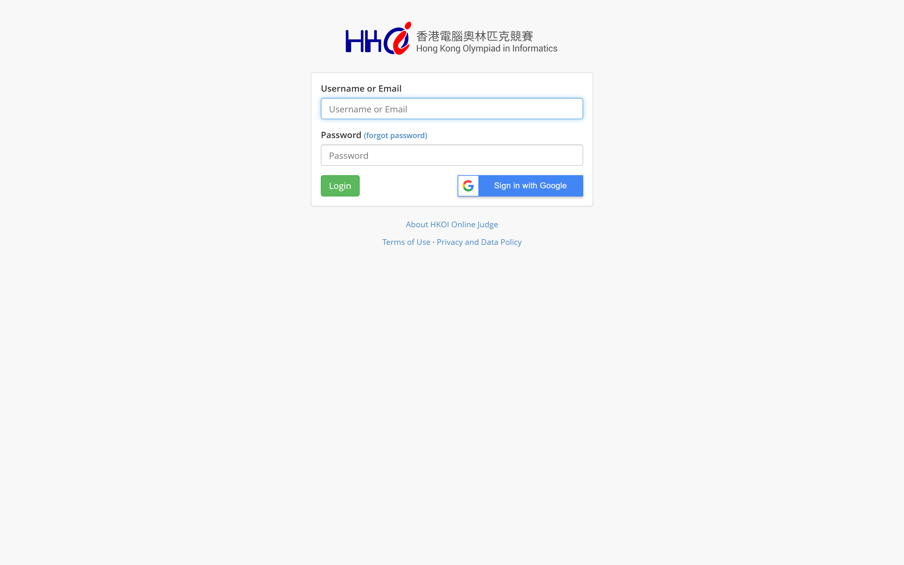
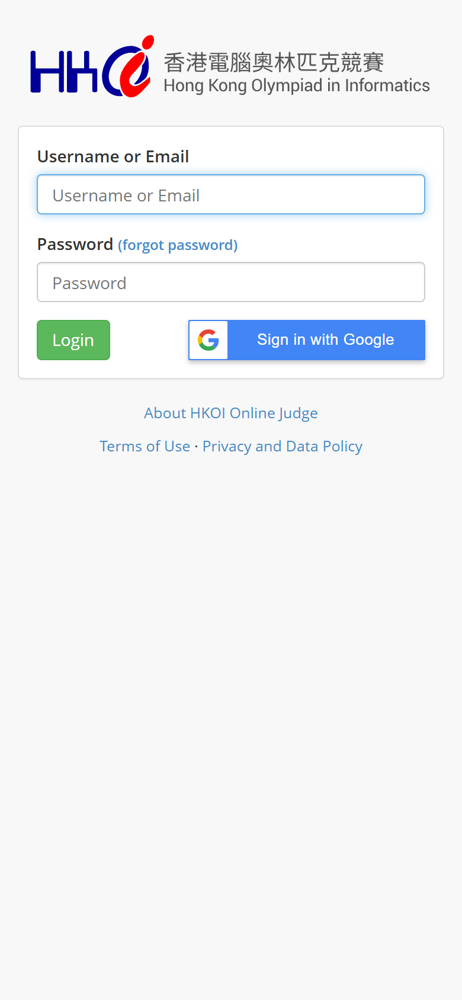
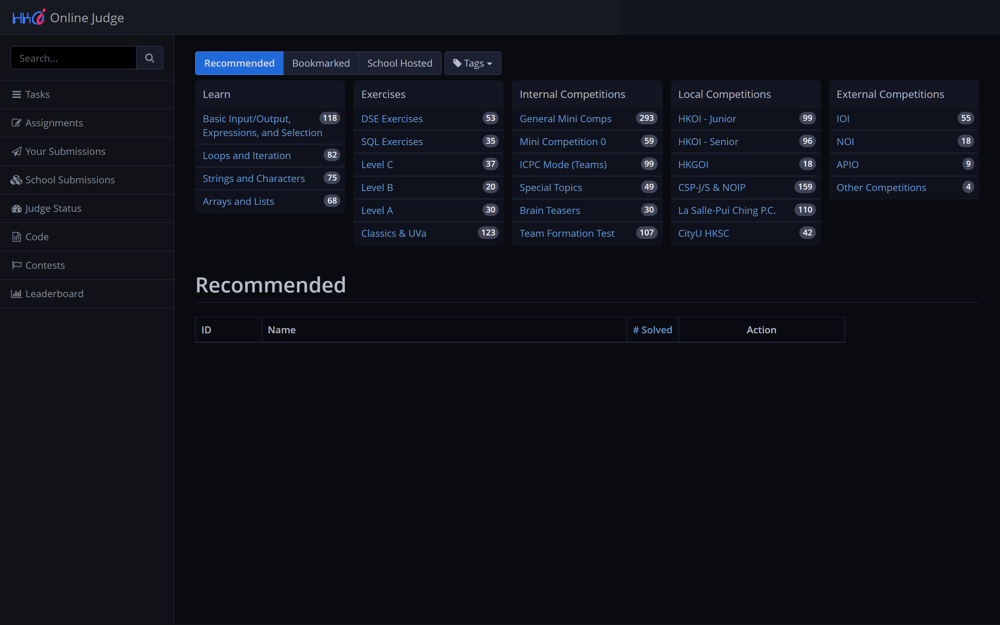
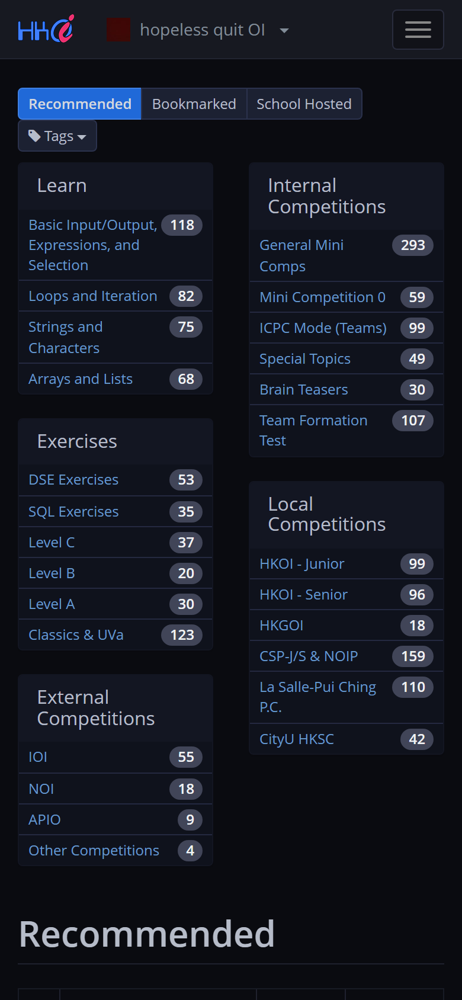

# UI1 · HKOJ（judge.hkoi.org）

> 小肥鱼 ｜ 采样 2026-11-25 18:52–19:20 (UTC+8)
> 采样方式：登录页等公开页面由无头浏览器直接抓取；站内页复用本机浏览器已有的站内会话做**只读**浏览 —— 未提交任何表单、未注册、未改账号设置。站内截图右上角的账号名与时钟已打码。
> 全部色值与尺寸来自「下载的 CSS 原文」或「Playwright getComputedStyle 实测」；未实测处标注**未能确认**。

## 0. 一句话结论

HKOJ 的价值不在 Bootstrap 3 皮肤，而在**工程分层**：一份 49 KB 的 `hkoi-dark.css`（607 条规则）把 2014 年的亮色后台整体压成暗色，并用一套语义类（`.result-accepted` / `.tasklist-solved`）在明暗两套里各自保住状态色可读性。**登录页是亮的、站内页是暗的**——这个断层既是反面案例，也证明「主题覆盖层必须集中成一个文件」是对的。

## 1. 站点与技术栈

### 1.1 技术栈（实测依据）

| 层 | 结论 | 证据 |
|---|---|---|
| CSS 框架 | **Bootstrap v3.2.0** | `bootstrap.css` 首行注释 |
| 后台皮肤 | SB Admin 2 | `sb-admin-2.css` 头注释 + `#page-wrapper`/`.sidebar` 结构 |
| 图标 | Font Awesome 4.7.0 + Glyphicons | 独立 CSS + bootstrap.css 内 `@font-face` |
| JS | jQuery 3.7.1 + bootstrap.min.js + metisMenu | 页面尾部 `<script>` |
| 后端 | Laravel（推断） | `csrf-token` meta、`XSRF-TOKEN` / `hkoi_session` cookie |
| 认证 | 站内账号 + Google Sign-In | `gapi.signin2.render()` |
| 编辑器 | CodeMirror（推断） | `#source-editor-cm .cm-wrap` |
| 主题 | `<body class="dark">` + 条件加载 `hkoi-dark.css` | 实测 `body.className === "dark  "` |

### 1.2 样式表加载顺序（关键差异）

```
登录页(4) : bootstrap → sb-admin-2 → fonts → font-awesome
站内页(10): bootstrap → metisMenu → sb-admin-2 → fonts?ver=20261001
            → hkoi-stream → jquery-ui → font-awesome → task-list
            → hkoi-dark?ver=20261001 → hkoi-assignment-autocomplete
```

登录页**不加载** `hkoi.css` / `hkoi-dark.css` / `metisMenu.css`——这是两套视觉断裂的根因，两者共用的只有 Bootstrap 默认皮肤。

### 1.3 路由（HTTP 状态码实测）

| 路径 | 状态 | 备注 |
|---|---|---|
| `/` | **302** → `/login` | 未登录重定向 |
| `/login` `/password/reset` `/terms?en` `/privacy?en` `/robots.txt` | 200 | 公开可读 |
| `/tasks` `/contests` `/submissions` `/help` `/code` `/assignments` `/leaderboard` `/settings` `/helpsql` | 302→/login（未登录）/ 200（已登录） | 存在 |
| `/submissions/user` `/submissions/school/144` `/task/:id` `/contest/:id` `/tag/:slug` `/group/:code` `/user/:name` | 同上 | 细分视图 |
| `/problems` `/problem` `/problem/1` `/contest` `/ranking` `/rank` `/submission` `/status` `/faq` `/about` `/register` `/users` `/teams` | **404** | 不存在 |
| `/scoreboard` / `/logout` | 301 → `/scoreboard/` / **405** | 遗留跳转 / 只收 POST |

命名无规律：`/tasks`（复数集合）+ `/task/:id`（单数个体），但 `/problems` 与 `/ranking` 全 404，排名真正路径是 `/leaderboard`。

## 2. 视觉体系

### 2.1 色板

**A. 公开层（亮色）** — 实测自 getComputedStyle

| 用途 | 实测值 | 对比度备注 |
|---|---|---|
| 页面底 / 面板底 | `#f8f8f8` / `#ffffff` | — |
| 正文 | `#333333` | on #f8f8f8 = **11.90:1** ✓ |
| 链接 / hover | `#428bca` / `#2a6496`+`underline` | **3.63:1** ✗ / 6.25:1 ✓ |
| 主按钮(成功) / hover | `#5cb85c` 边 `#4cae4c` / `#449d44` 边 `#398439` | 白字=**2.48:1** ✗ / 3.41:1 ✗ |
| 危险 / 警告 / 信息 | `#d9534f` / `#f0ad4e` / `#5bc0de` | 3.96 / **1.95** / **2.09** ✗ |
| 面板边框 / 输入边框 | `#dddddd` / `#cccccc` | 1.36:1（非文字，仅分隔） |
| 输入文字 / 占位 | `#555555` / `#999999` | 7.46:1 ✓ / **2.85:1** ✗ |
| 焦点环 | 边 `#66afe9` + `0 0 8px rgba(102,175,233,.6)` | 2.37:1，靠光晕补 |
| 数字徽标底 | `#777777` | 白字 4.48:1（差 0.02 到 AA） |
| 结果态 通过 / 失败 | `#1a1`(#11aa11) / `#b11`(#bb1111) | **3.10:1** / 6.56:1 |
| 行状态边条 / 侧栏 hover | `#494`(#449944) 3px / 底 `#edeff5`+条 `#2a6496` | 3.57:1（图形达 3:1）/ 5.43:1 ✓ |

**B. 站内层（`body.dark`）** — 实测自 getComputedStyle + hkoi-dark.css

| 用途 | 实测值 | 对比度备注 |
|---|---|---|
| 页面底 / 顶栏 / 面板标题条 | `#111218` / `#171921` / `#131622` | 面板与页面同色，仅靠边框区分 |
| 正文 / 强调 / 最强 | `#b6bcc9` / `#d3d7de`(高频 30 次) / `#e2e4e9` | 9.81 / 12.95 / 14.69:1 ✓ |
| 次要 / 侧栏文字 | `#818c98` | 5.46:1 ✓ |
| 链接 | `#6699cc` | **6.22:1** ✓ |
| 按钮底 / 字 | `#2069d8` / `#d3d7de` | 3.57:1（仅大字级） |
| 徽标底 / 字 | `#414558` / `#f0f2f4` | 8.44:1 ✓ |
| 表格线（表头 2px / 单元格） | `#1f212e` / `#292c3d` | 1.17 / 1.35:1——极弱，靠留白 |
| 输入底 / 边框 / 占位 | `#000` / `#29333d` / `#999` | 占位 7.37:1 ✓ |
| 结果态 通过 / 失败 / 警告 | `#46b546` / `#d73c38` / `#f69915` | **7.08** / 4.09 / 8.44:1 |
| 已参加比赛行 | `#13201a`（暗绿） | 与底色差异极小，仅作暗示 |

**暗色层（2026 年新增，`ver=20261001`）对比度全面优于 2014 年的亮色层**。老亮色的链接(3.63)、按钮白字(2.48)、警告橙(1.95) 是硬伤。

### 2.2 字体与字号

```css
body, .btn { font-family: 'Noto Emoji', 'Open Sans', 'Microsoft JhengHei', dotum; }  /* 登录页内联 + hkoi.css 各声明一次 */
代码块      { font-family: "Inconsolata", Consolas, "Courier New", monospace; }
```

**降级链为什么这么排（逐级实测验证）**：

| 顺位 | 字族 | 实际作用 |
|---|---|---|
| 1 | `Noto Emoji` | **只**接管 emoji 字形。CDP `CSS.getPlatformFontsForNode('body')` 返回**空数组**（body 无字形），证明正文一个字符都不走它 |
| 2 | `Open Sans` | 承担全部正文，但**不是真 Open Sans**：`fonts.css` 内注释原文 `/* Noto Sans 400 disguised as Open Sans 350 for condensed. */`，`src` 指向 `fonts.gstatic.com/s/notosans/...` |
| 3 | `Microsoft JhengHei` | 中文（HK 用字）兜底，未触发（页面无中文正文） |
| 4 | `dotum` | 韩文字族，实际死代码，未触发 |

`getComputedStyle` 只回声明值；CDP 平台字体报告才给出真相：`#email` → `Open Sans`(`isCustom:true`, 17 字形)，`label` → **`Open Sans Semibold`**（600 权重命中 `local()` 别名）。站点用 `@font-face` 的 `local()` + 自定义字重（350/400/600）拼出一套"假 Open Sans"。

| 场景 | font-size | line-height | 字重 |
|---|---|---|---|
| `html` | **10px**（Bootstrap 3 的 rem 基数） | — | — |
| `body` / `label` / `input` / `.btn` | 14px | **20px**（1.4286） | 400 / **700** / 400 / 400 |
| `small`（含 forgot password） | **11.9px**（85%） | 17px | 700 |
| 页脚 `font-size:90%` 块 | **12.6px** | 18px | 400 |
| 站内 `h1.page-header` | **30px** | 33px | **600** |
| hkoi.css 高频字号 | **12px**(10 处) > 13px(4) > 14px(3) > 10px/15px/18px | — | bold(18 处) |
| 代码块 | 16px | 18px | — |

`html{10px}` 与 `body{14px}` 并存：任何 `rem` 都以 10px 为 1rem，与 14px 基准错位。

### 2.3 间距、圆角、阴影、边框

| Token | 值 | 出现位置（实测） |
|---|---|---|
| 内边距 | **15px** | `.container{padding:0 15px}`、`.panel-body{padding:15px}`、`.form-group{margin-bottom:15px}` |
| 标签↔输入 | **5px** | label 底 151 → input 顶 156 |
| 面板间距 | **20px** | `.panel{margin-bottom:20px}`（panel 底 329 → 页脚 349） |
| 面板顶距 | **22.5px** | `.login-panel{margin-top:5%}` = 5% × 450px 容器**宽** |
| 控件高 | **34px** | input 与 .btn 实测均 34（content 20 + padding 12 + border 2） |
| 表格单元格 | 8px 8px 7px | 站内实测，hkoi.css 把 Bootstrap 的 8px 改成不对称 8/8/7 |
| 面板标题条 | 10px 15px → 站内 **10px 0 10px 10px** | 右侧留 0 让 badge 贴边 |
| 内容区留白 | 30px | `#page-wrapper{padding:0 30px 30px}` |
| 侧栏宽 | **250px**（实测） | hkoi.css 声明 200px，实测被覆盖为 250px |

**圆角**：4px（面板 / 按钮 / 输入框 / 面包屑）、3px（面板标题条上圆角，补偿嵌套 1px 边）、10px（数字徽标药丸，`min-width:10px`）、50%（头像）、0（表格与代码块）。

**阴影**（4 层）：`0 1px 1px rgba(0,0,0,.05)` 面板浮起（暗色下不可见）、`inset 0 1px 1px rgba(0,0,0,.075)` 输入内凹（暗色下失效）、上述 + `0 0 8px rgba(102,175,233,.6)` 输入焦点光晕、`4px 4px 16px 12px rgba(0,0,0,.4)` 弹层遮罩。

边框全场 1px solid；表头下边线 2px；已解决行左侧 **3px** 色条。

## 3. 登录页拆解（逐元素）




| # | 元素 | 实测尺寸 | 计算样式要点 |
|---|---|---|---|
| 1 | `.container` | 480×405 @x=480 | `max-width:480px`（**内联覆盖** Bootstrap 的 1170），`padding:0 15px` |
| 2 | logo 区 `div[style="margin-top:5%"]` | 450×70，y=22.5 | 5% × 450 = **22.5px**（相对宽度，非高度） |
| 3 | `img.hkoilogo` | 350×70 | 源 SVG `hkoifull.svg` 为 600×120 viewBox，`max-height:70px` 约束 |
| 4 | `.login-panel.panel.panel-default` | 450×214 @x=495 | 底 #fff / 边 1px #ddd / 圆角 4px / `shadow 0 1px 1px rgba(0,0,0,.05)` / `margin-top:22.5px` |
| 5 | `.panel-body` | 448×212 | `padding:15px` |
| 6 | `label[for=email]` | 128.77×20，y=131 | 14px / **700** / margin-bottom 5px / #333 |
| 7 | `#email.form-control` | 418×34，y=156 | padding 6 12 / 圆角 4 / **处于 focus**（页面 JS 自动聚焦）：边 #66afe9 + 8px 光晕 |
| 8 | `label[for=password]` | 含 `small>(forgot password)` | small = 11.9px / 700 / 链接 #428bca |
| 9 | `#password.form-control` | 418×34，y=230 | 非焦点：边 `#ccc` + `inset 0 1px 1px rgba(0,0,0,.075)` |
| 10 | `.btn.btn-success`(Login) | **61.5×34** @x=511 | #5cb85c / 边 #4cae4c / 白字 14px / padding 6 12 / **无 min-width，宽度靠内容撑** |
| 11 | Google 按钮 | 200×34 @x=729 | `pull-right` 浮右，与 Login 间留 **156px 空洞** |
| 12 | 页脚 `.text-center[style="font-size:90%"]` | 450×46，y=349 | 12.6px/18px，两行：About 一行、Terms · Privacy 一行 |
| 13 | 页脚链接 | — | `#428bca`、**默认无下划线**（:hover 才加）；12.6px + 3.63:1 = 双重可读性风险 |

**响应式实测**（三档均无横向溢出，`scrollWidth === clientWidth`）：

| 视口 | container | panel | logo | `margin-top:5%` |
|---|---|---|---|---|
| 1440×900 | 480 | 450 @x=495 | 350 @x=545 | 22.5px |
| 768×1024 | 480 | 450 @x=159 | 350 @x=209 | 22.5px |
| 390×844 | 390 | **360** @x=15 | 350 @x=20 | **18px** |

字号、控件高、按钮宽在三档**均不变**，唯一变化是面板宽度随容器收缩。

**结构性缺陷**：① 全页无 `<h1>`，最顶层标题是 `label`；② body 实测高 405px 而视口 900px，下方 495px 全空——`margin-top:5%` 是顶部间距不是居中；③ Login 61.5px 与 Google 200px 并排失衡，视觉重心偏右；④ logo 深蓝+品红，主按钮却是 Bootstrap 草绿 #5cb85c，成功色被当品牌色。

## 4. 内部页面能推断出什么

> 已实测截图：`tasks`(桌面/移动) / `contests` / `submissions` / `leaderboard` / `help` / `group`。**题目详情页未取得**（`/tasks` 与 `/group/E1` 的 `tbody` 实测 0 行，题目链接为交互后渲染），4.2 以下全部为**推断**。




### 4.1 已实测的骨架（非推断）

| 区域 | 实测值 |
|---|---|
| 顶栏 `nav.navbar` | 高 **50px** / `#171921` / 下边 1px `#212430` / `position:relative` |
| 侧栏 `.sidebar` | 宽 **250px** / `#111218` / `position:absolute` / `margin-top:51px`（顶栏 50+1） |
| 内容区 `#page-wrapper` | `margin-left:250px` / `padding:0 30px 30px` / 左边 1px `#212430` / 实测宽 1190 |
| 侧栏导航项 | 14px / `#818c98` / `padding:10px 15px` + Font Awesome 前置图标 |
| 表格 | `.table.table-striped.table-bordered.table-hover`，单元格 `8px 8px 7px`，表头 700 + 2px `#1f212e`，单元格线 `#292c3d` |
| 页面标题 | `h1.page-header` 30/33/600/`#b6bcc9` + `padding-bottom:9px` + 1px 下边线 |
| 数字徽标 | 药丸 10px 圆角 / 12px 粗体 / `#414558` 底 / `#f0f2f4` 字 |
| 分段按钮组 | 激活 `#2069d8` 底 + `#d3d7de` 字 + 34px 高（Recommended / Bookmarked / School Hosted） |
| 输入框 | 34px / `#000` 底 / `#29333d` 边 / 占位 `#999` |
| 移动端 390 | 侧栏 `display:block; position:static`（**折叠进汉堡，不做抽屉**），`.navbar-toggle` 显示，内容区 `padding:0 15px 15px`，无溢出 |

### 4.2 推断：题目页与编辑器（依据 hkoi.css 类名）

- `.tasklist td:first-child{white-space:nowrap}`、`td.actions{text-align:center}`、`td.recommended{text-align:left}` → 题目列表是**单表多列**，不是卡片流。
- `table.table-striped>tbody>tr.tasklist-solved>td:first-child{border-left:3px solid #494; padding-left:7px}` → **已解决用 3px 左边条表达，不加新列**。全站最值得抄的一招。
- `.testdata-table{table-layout:fixed}` + `.testdata-content{max-height:200px; font-family:Inconsolata; font-size:16px; line-height:18px; white-space:pre}` → 测试数据等宽字体、限高 200px 内滚。
- `.profile-solved a{width:44px; font-size:10px; padding:8px 0; line-height:10px; background:#f6f6f6; border:1px solid #eee; color:#666}`，`.a`=绿底白字、`.b`=`#f2dede` 底 `#a94442` 字 → 用户主页 44px 宽的"题目格子墙"。
- `.user-card.popover .popover-content{width:560px!important; height:190px!important; display:flex}` + `.thumb{flex:0 0 160px}` → 悬停用户名弹出 560×190 卡，左 160px 头图。
- `body.code-editor-mode` 是一整套**全屏编码模式**：`.hide-on-code-editor-mode{display:none}`、`#page-wrapper{display:flex; flex-direction:column; min-height:calc(100vh - 50px)}`、`#wrapper{position:absolute; height:100%; overflow-y:auto}`。
- `.source-editor-files{flex-basis:240px}` + `.editing{background:rgba(110,128,168,.2)}` → 编辑器左侧 240px 文件列表，当前文件半透明蓝底高亮。
- 结果态：`.result-accepted{font-weight:bold; color:#1a1}` / `.result-hacked{...color:#b11}`，暗色对应 `#46b546` / `#d73c38`；特定比赛 AC 用 `#ff5fa2` + `:after{content:" ❤"}`。
- 本地化：`body[locale=en] .submissions-table .result-tle:before{content:"Time Limit Ex"}` → **用 CSS `content` 注入界面文案**，HTML 里只有图标。技术巧妙，但把文案搬出 DOM，对爬虫与翻译流程不友好。

## 5. 对我们项目的可迁移点

> 现状数据来自本项目 `assets/css/` 实测统计。

**5.1 主题覆盖层集中成单文件**
- 现状：`data-theme` 覆盖散在 6 个文件——`styles.css`(dark 39 / scifi 51)、`user.css`(18/12)、`problems.css`(13/10)、`pd.css`(20/4)、`submissions.css`(6/6)、`port.css`(1/1)，合计 **181 处**。
- 建议：抽出 `themes/dark.css`、`themes/scifi.css`，只放「改写变量」的覆盖，组件规则一律读 `var(--x)`。HKOJ 可作模板：单文件 607 条规则、一个开关 `body.dark`。
- 收益：调主题只读一个文件；加第四套主题从「翻 6 个 CSS」降到「复制一份变量表」。

**5.2 判题状态用「双主题成对色」**
- 现状：`pd.css` 已有 `.feedback-box.status-accepted{background:#1b4d2e;color:#8fdf8f}` 这类暗色专用色，但散落且只有部分状态有。
- 建议：定义 `--verdict-ac/wa/tle/re` 四变量，每套主题各给一组，参照 HKOJ 实测：亮 `#1a1`(3.10:1) / `#b11`(6.56:1)，暗 `#46b546`(7.08:1) / `#d73c38`(4.09:1)。
- 收益：三套主题下判题色都 ≥4:1，不必逐页修补。

**5.3 列表状态用 3px 左边条**
- 现状：题目/提交列表用图标或整列文本表达「已解决」。
- 建议：`tr.is-solved > td:first-child{border-left:3px solid var(--verdict-ac); padding-left:7px}`（HKOJ 原文 `3px solid #494` + `padding-left:7px`）。
- 收益：扫视即见进度；390px 下不额外占列宽（HKOJ 移动端实测无溢出）。

**5.4 窄容器登录卡的三断点**
- 现状：`login.html` 用 `.login-container > .login-card`。
- 建议：容器 `max-width:480px`，三档实测落差仅 450 → 450 → 360，即「桌面锁 450、移动跟屏减 30」。
- 收益：一套尺寸覆盖全部断点，不为平板单独写规则。

**5.5 数字徽标给分类计数**
- 现状：分类计数多以纯文本夹在标题里。
- 建议：`padding:3px 7px; border-radius:10px; font-size:12px; font-weight:bold; min-width:10px`，亮 `#777` 底白字、暗 `#414558` 底 `#f0f2f4` 字（8.44:1）。
- 收益：计数与名称扫视分离，徽标右对齐后各卡片纵列齐整。

**5.6 全屏编码模式（成本最高）**
- 现状：编辑器与导航同屏，`--topbar-height:60px` + `--sidebar-width:250px` 常驻。
- 建议：加 `body.code-editor-mode`，进入时隐藏侧栏、内容区 `display:flex; flex-direction:column; min-height:calc(100vh - var(--topbar-height))`。
- 收益：可用高度从 ~700px 提到近满屏，退出即恢复，无需改路由。

## 6. 明确不该学的部分

1. **百分比 margin 做垂直定位**：`.login-panel{margin-top:5%}` 实测 450px→22.5px、360px→18px，垂直位移跟着**宽度**漂移。
2. **按钮宽度靠 padding 撑**：Login 实测 61.5×34，与 200px 的 Google 按钮间留 156px 空洞，至少该给 `min-width`。
3. **把成功色当品牌色**：草绿 #5cb85c 是语义「成功」，却成了登录主按钮，与蓝红 logo 冲突，白字对比度仅 2.48:1。
4. **`body{overflow-y:scroll}`**（`sb-admin-2.css` 第 6 行）：强制常驻滚动条，短页面右侧永远一条灰槽。
5. **非 4 倍数尺度**：内边距 15、控件高 34、单元格 8/8/7（不对称）。想对齐 8pt 网格处处要打补丁。
6. **每页重复内联 `<style>`**：`.hkoilogo` 在登录页与 terms 页各写一次；登录页还内联 24 行 `#login-form` loading 遮罩。
7. **`font-weight:350` 伪字重**：`fonts.css` 自承「Noto Sans 400 disguised as Open Sans 350」，任何不吃 `@font-face` 自定义字重的渲染路径都会退回 400。
8. **暗色沿用亮色阴影**：`0 1px 1px rgba(0,0,0,.05)` 压在 `#111218` 上等于没有；面板与页面同底色，只靠 1.17:1 的边框分隔，边界靠猜。
9. **`text-shadow:1px 1px 1px #fff`**（侧栏 hover，hkoi.css 原文）：2013 年的浮雕手法，暗色下完全失效。
10. **路由命名不一致**：`/problems`、`/ranking`、`/register` 全 404，真正路径是 `/tasks`、`/leaderboard`。外部无法靠猜进入任何页面。
11. **依赖已停服的 Google Sign-In**：登录页仍调用 `gapi.auth2`（Google 2023 年已停用），按钮能渲染但授权流程不可靠。

## 7. 参考数据

### 7.1 采样与文件

| 项 | 值 |
|---|---|
| 时间 / 浏览器 | 2026-11-25 18:52–19:20 (UTC+8) / Chromium 156.0.8078.4（Playwright 1.64.0 headless） |
| 截图 DPR | 2（1440×900 → 2880×1800 文件） |
| 下载的样式表 | `bootstrap.css` 126,301 B、`sb-admin-2.css` 4,998 B、`fonts.css` 10,062 B、`hkoi.css` 28,415 B、**`hkoi-dark.css` 49,056 B**、`task-list.css` 2,526 B、`hkoi-stream.css` 934 B、`metisMenu.min.css` 586 B |
| 规则条数 | `hkoi.css` 373 条、`hkoi-dark.css` **607 条**、`sb-admin-2.css` 137 行 |

### 7.2 原始记录

| 文件 | 内容 |
|---|---|
| `raw/computed.json` `raw/computed2.json` | 登录页 getComputedStyle（桌面/移动）、三断点尺寸、hover/focus 态 |
| `raw/internal.json` `raw/internal-styles.json` | 5 个站内页骨架实测 + 语义色（h1/link/badge/btn/stripe/input） |
| `raw/contrast.json` `raw/dark-extract.txt` `raw/hkoi-extract.txt` | 亮色 17 组对比度 / 暗色 607 条规则摘要+色频 / hkoi.css 组件摘要 |

（以上路径均相对 `temp/ui-study/hkoj/`）

### 7.3 暗色高频色值（hkoi-dark.css 原文，按次数）

```
#d3d7de 30  #b6bcc9 18  #fff 16  #e2e4e9 15  #272935 10  #212430 8  #1f212e 7
#1c2132 7  #1a6d86 7  #181b25 6  #384163 6  #131622 6  #1c5ec2 6  #9f6006 6
#8c1f1c 6  #296b29 6  #111218 5  #0a0b10 5  #2069d8 5  #b76e07 5  #a12421 5
#b245db 5  #307e30 5  #1e7f9b 5  #be2084 5  #5d94e7 4  #292c3d 4  #f69915 3
#d73c38 3  #46b546 3
```

### 7.4 未能确认

| 项 | 原因 |
|---|---|
| 题目详情页 `/task/:id` 实际排版 | `/tasks` 与 `/group/E1` 的 `tbody` 实测 0 行，题目链接为交互后渲染；4.2 节全为**基于类名的推断** |
| `/code` 与全屏编辑器观感 | 未进入该页截图，`body.code-editor-mode` 仅从 CSS 反推 |
| 站内**亮色**主题（`body` 无 `dark`）的完整表现 | 当前账号处于暗色模式，无法在不改用户设置的前提下采样 |
| `/assignments` `/settings` `/tag/:slug` 样式 | 未截图 |
| 字体文件的实际来源与授权 | `src` 指向 `fonts.gstatic.com/s/notosans/*` 却声明为 `Open Sans`，属站点自身打包策略 |
| Google Sign-In 是否仍能完成授权 | 未提交任何表单，仅确认按钮渲染 |
